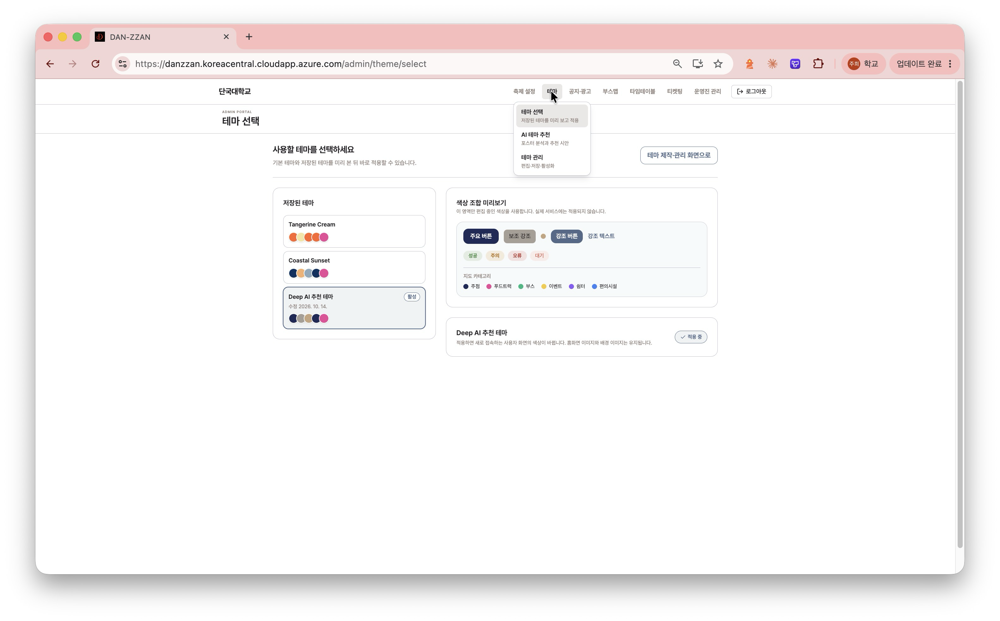
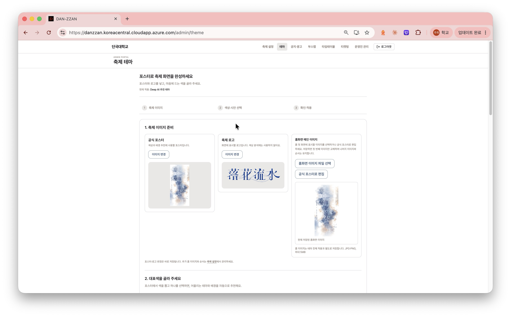
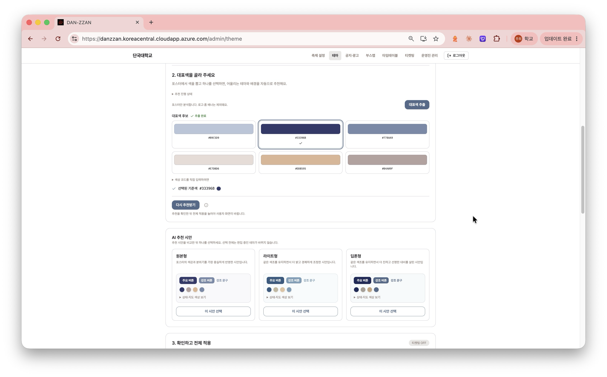
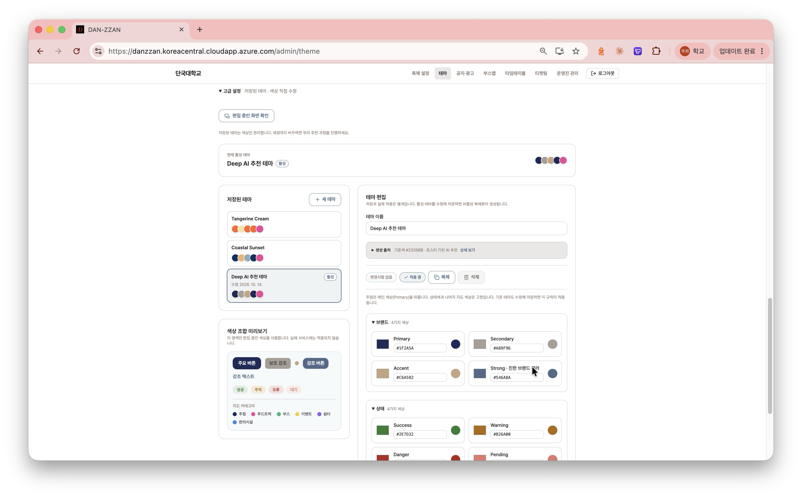
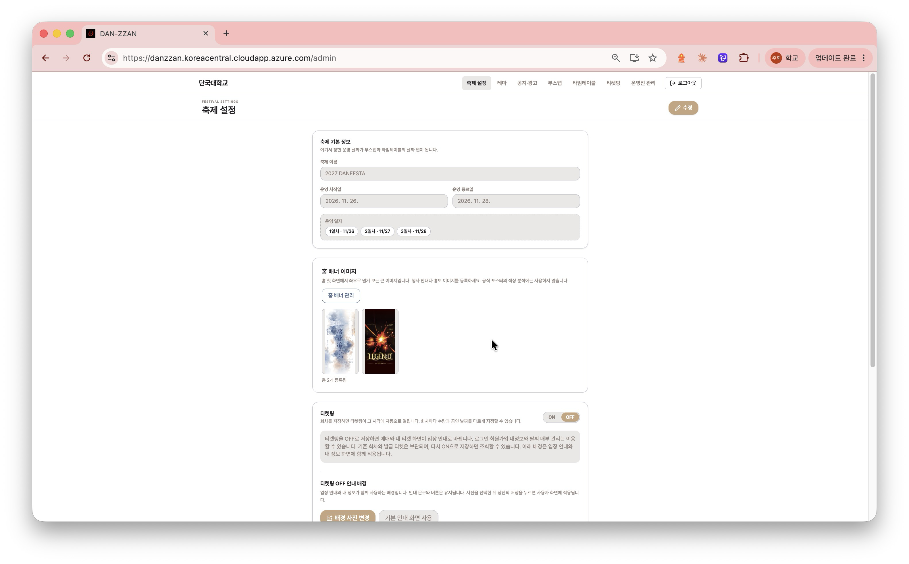

# DANZ-373 Azure 관리자 화면 캡처

2026-10-14 사용자가 제공한 Azure 배포 화면 캡처입니다. 원본 PNG를 수정 없이 보관했습니다. 화면의 테마·축제 이름·운영 날짜는 촬영 당시 설정이며, 날짜 이관 직후 상태를 증명하는 자료가 아닙니다. 이 자료 추가 과정에서는 서비스 설정이나 데이터를 변경하지 않았습니다.

## 테마 선택 전용 화면

테마 하위 메뉴와 별도 선택 화면에서 기본 프리셋·저장된 테마, 색상 미리보기 및 현재 적용 상태를 확인합니다.

## 축제 이미지 준비와 홈 이미지 관리

공식 포스터·로고·홈 이미지의 역할을 나누고 홈 이미지 파일 선택과 포스터 편집 진입 버튼을 제공합니다. 이 캡처는 현재 저장된 홈 이미지를 표시한 상태이며, 새 파일 선택 후의 저장·취소 버튼은 포함하지 않습니다.

## 대표색 선택과 AI 추천 시안

포스터에서 추출한 대표색 후보와 선택된 기준색, 원본형·라이트형·딥톤형 추천을 비교하는 화면입니다. 추천 영역의 화면 예시이며, 이 캡처만으로 이번 PR에서 AI 추천 기능 전체가 새로 추가되었다거나 적용까지 완료되었다고 해석하지 않습니다.

## 저장된 테마와 색상 편집

제작 화면 하단에도 테마 목록을 유지합니다. 펼쳐진 고급 설정·브랜드·상태 영역과 고정 색상 정책 안내를 확인할 수 있습니다. 지도 색상 상세 입력 영역은 캡처 아래쪽에 있어 포함되지 않습니다.

## 축제 설정의 세로형 홈 이미지 미리보기

등록된 두 홈 이미지를 세로형 썸네일로 표시합니다. 실제 사용자 홈의 전체 영역 cover 표시와는 별도의 관리자 미리보기입니다.

