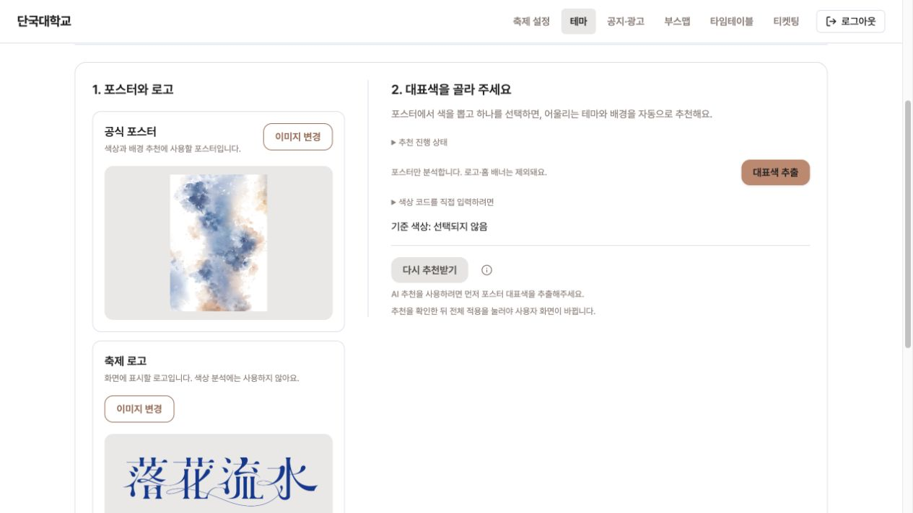
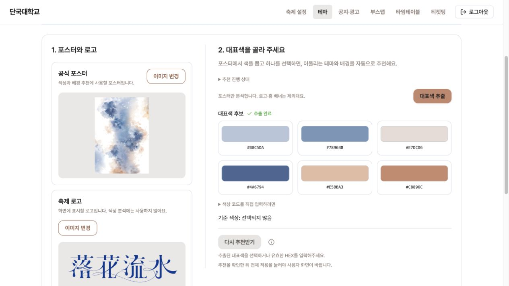
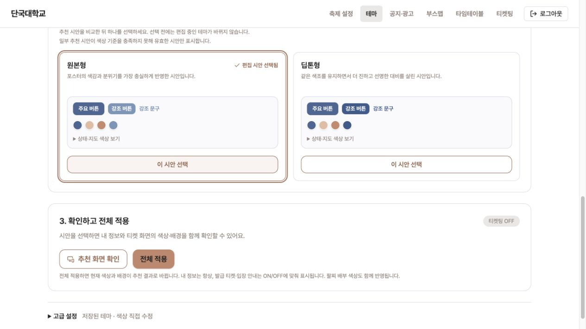
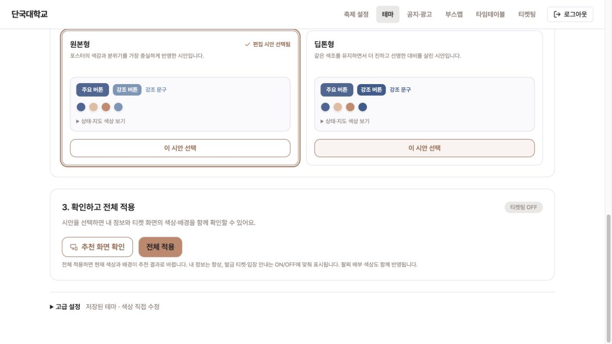
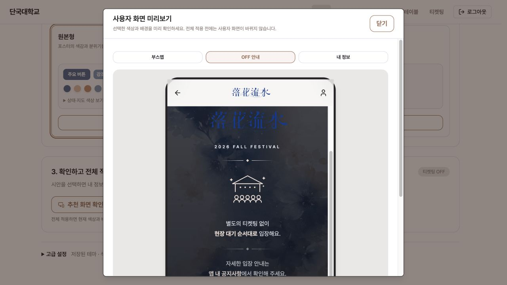
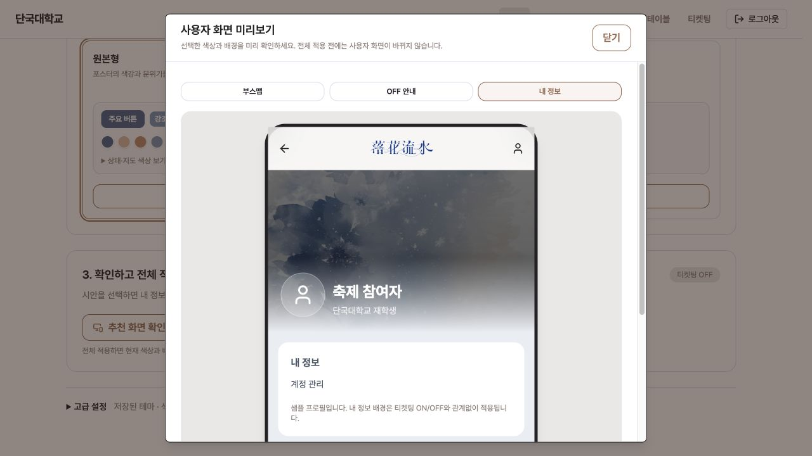
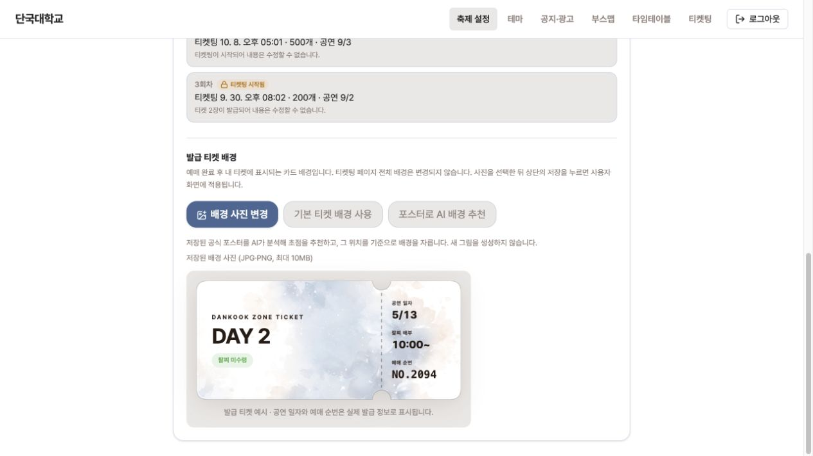
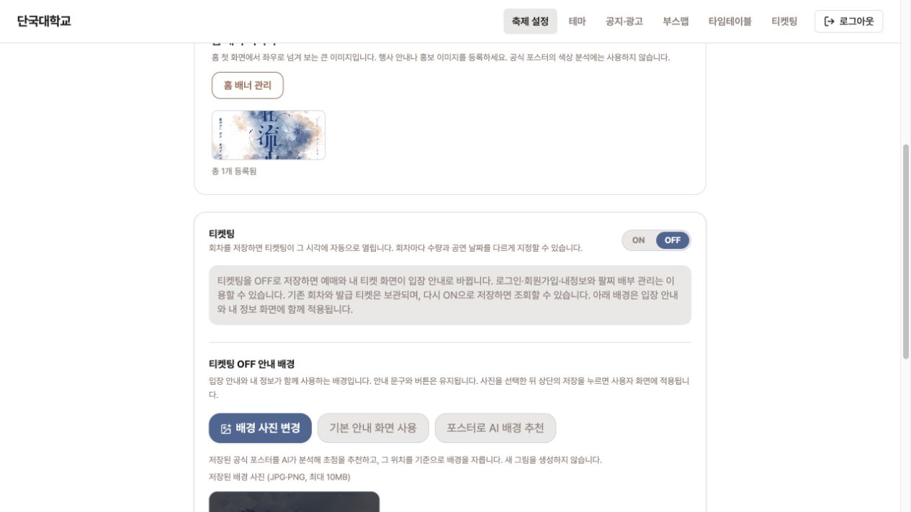
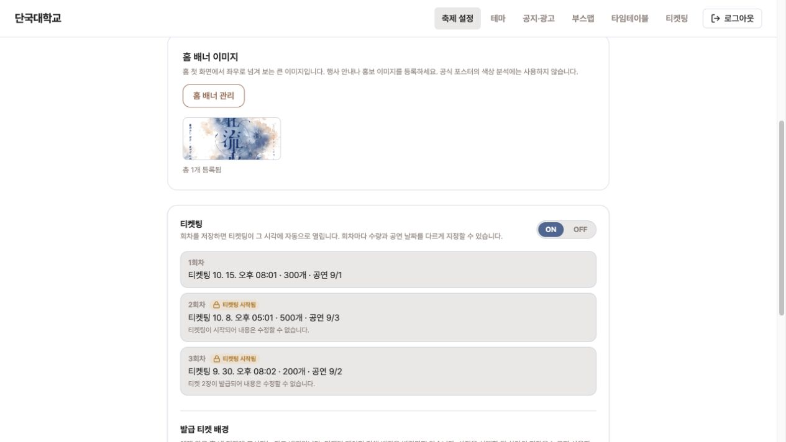

# DANZ-374 로컬 화면 검증

2026-10-12, Docker FE·BE + localhost:5173에서 실제 브라우저 화면을 촬영했습니다. 현재 저장된 푸른 포스터와 로고를 사용했으며 새 이미지를 생성하거나 화면을 합성하지 않았습니다. 추천 결과는 미적용 상태로 캡처했습니다. ON/OFF 확인 후 기존 OFF 상태로 복구했고 활성 테마·배경 URL·포스터·로고·회차가 촬영 전과 동일함을 API로 확인했습니다.

## 1. 공식 포스터와 로고

색상 분석은 공식 포스터만 사용합니다. 로고는 사용자 화면에 표시할 이미지이며 홈 배너는 축제 설정으로 이동했습니다.

## 2. 대표색 추출

저장된 포스터에서 대표색 후보를 추출합니다. 후보 하나를 선택하면 색상 시안과 가로·세로 배경 추천을 자동으로 시작합니다.

## 3. 추천 시안 선택

실제 AI 응답에서 유효한 원본형·딥톤형 시안이 표시된 사례입니다. 원본형을 선택한 편집 상태이며 아직 전체 적용하지 않았습니다.

## 4. 확인하고 전체 적용

색상 시안 선택과 두 배경 준비가 끝나면 추천 화면 확인·전체 적용을 제공합니다. 중복된 배경 원본 썸네일은 표시하지 않습니다.

## 5. 티켓팅 OFF 안내 미리보기

추천 세로 배경과 선택한 테마의 본문·강조색을 확인합니다. OFF에서는 발급 티켓 탭이 없고 안내 탭이 표시됩니다. 화면 내부를 스크롤하여 안내 본문을 촬영했습니다.

## 6. 내 정보 미리보기

동일한 추천 세로 배경을 내 정보에도 사용합니다. 샘플 프로필이며 실제 회원 정보가 아닙니다. 티켓팅 ON/OFF와 관계없이 적용됩니다.

## 7. 발급 티켓 배경과 글자색

로컬 설정을 잠시 ON으로 전환하여 기존에 저장된 테마·배경의 발급 티켓 예시를 확인했습니다. 3~6번의 미적용 시안과는 구분됩니다. 글자색은 테마에서 파생되며 밝은 오버레이를 사용하고 상태 배지는 의미를 유지합니다.

## 8. OFF일 때 배경 편집

OFF 안내와 내 정보가 함께 사용하는 세로 배경 편집만 표시합니다. AI 추천 후 저장하기 전에는 공개 설정이 바뀌지 않습니다.

## 9. ON일 때 배경 편집

ON 상태와 보존된 회차를 확인합니다. 아래에는 발급 티켓 배경 편집만 이어집니다(카드 전체는 7번). 홈 배너 관리는 축제 설정에 배치했습니다.

## 검증

- FE: 123개 파일, 581개 테스트 통과(coverage 실행 포함). lint, 구조 검사, 의존성 순환 검사, 앱·테스트 타입 검사, build, bundle budget 통과.
- BE: 총 486개 테스트 중 실패 0, 오류 0, 건너뜀 12. clean test bootJar 통과.
- 기존 구조 allowlist 만료 알림과 Browserslist 데이터 갱신 알림은 남아 있으며 새 규칙 위반은 0건입니다.
- 운영 배포와 실제 기기 테스트는 수행하지 않았습니다.
