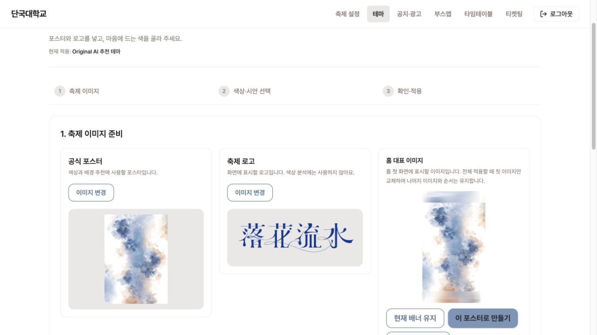
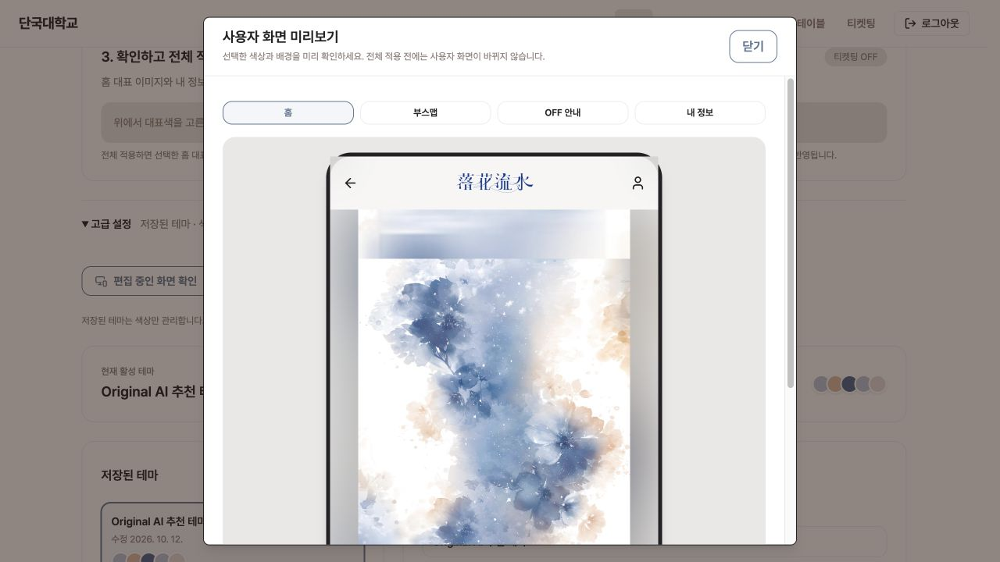
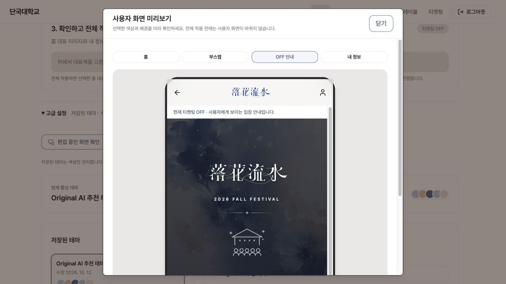
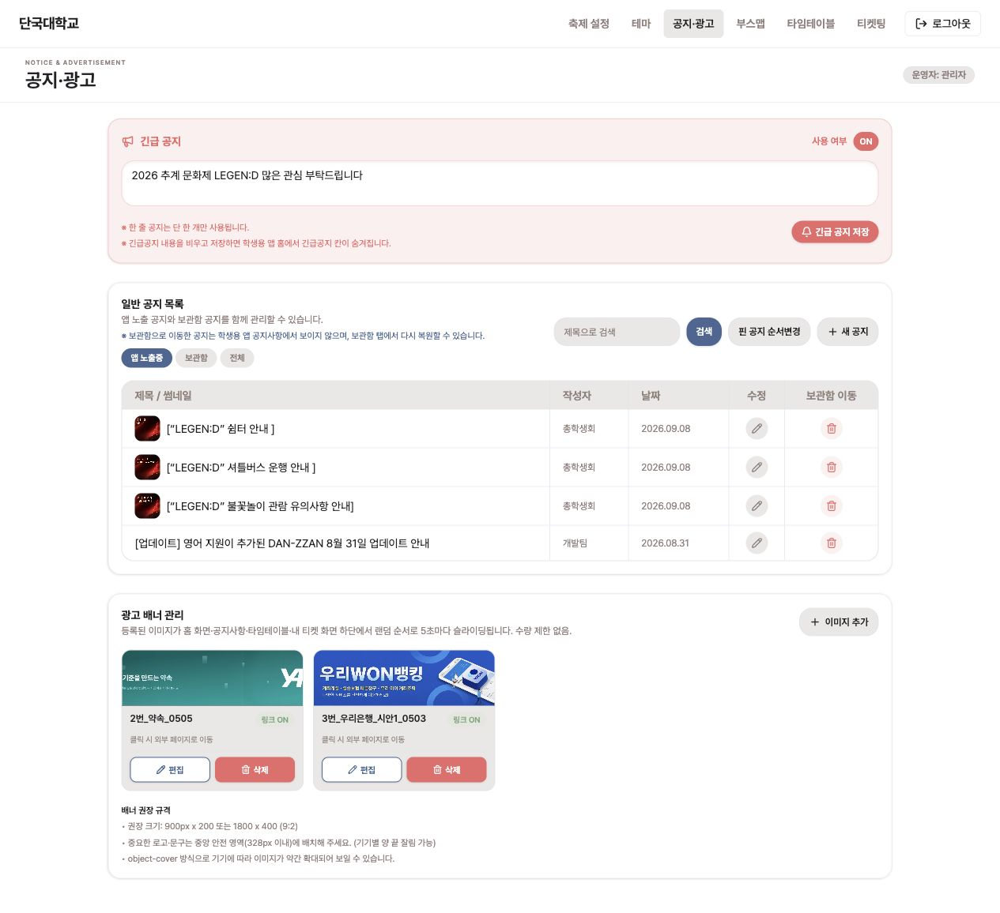
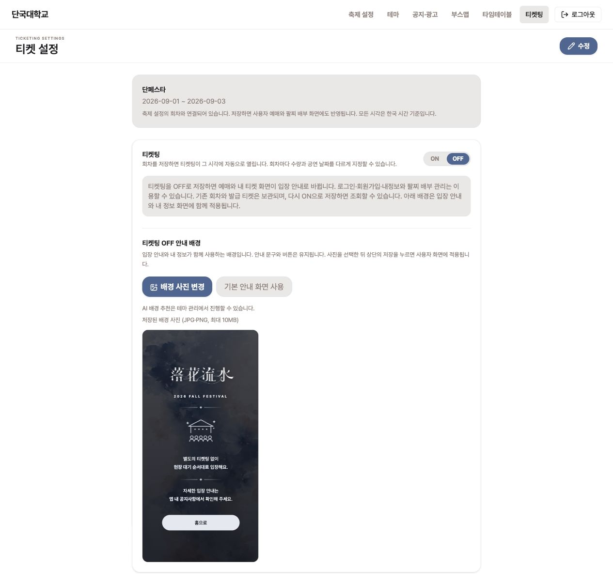

# DANZ-374 로컬 화면 검증

2026-10-12 로컬 Docker FE·BE와 localhost:5173에서 실제 브라우저로 촬영했습니다. 이미지 합성 없이 저장된 공식 포스터·로고를 사용했습니다.

## 최신 흐름 1. 축제 이미지 준비

공식 포스터와 로고 옆에서 홈 대표 이미지를 준비합니다. 기존 이미지 유지, 같은 포스터로 만들기, 별도 이미지 등록 중 선택합니다. 공식 포스터·로고 업로드는 즉시 저장되고, 홈 초안은 전체 적용 때 게시됩니다. 추가 홈 이미지·순서 관리는 축제 설정에 남습니다.

## 최신 흐름 2. 홈 화면 미리보기

서버가 생성한 900×1600 JPEG 초안을 홈 탭에서 확인했습니다. 실제 홈과 동일하게 포스터 전체를 보존하고 여백에는 흐린 배경을 사용합니다. 미리보기 전후 공개 홈 이미지 목록이 동일함을 API로 확인했습니다. 이 캡처는 전체 적용 전 상태입니다.

## 최신 흐름 3. 어두운 화면 로고

어두운 OFF 안내에서는 로고를 밝은 단색으로 표시하고, 밝은 상단 헤더는 원본 색상을 유지합니다. 원본 로고 파일은 변경하지 않습니다.

## 최신 흐름 4. 공지·광고 통합 관리

상단 메뉴는 드롭다운 없이 이 페이지를 바로 엽니다. 긴급 공지, 일반 공지, 광고 배너가 같은 페이지에 순서대로 표시됩니다. 기존 광고 주소로 직접 들어와도 통합 페이지의 광고 영역으로 이동하는 것을 실제 브라우저에서 확인했습니다. 촬영 중 공지/광고 데이터를 수정하거나 삭제하지 않았습니다.

## 최신 흐름 5. 티켓 설정 정리

티켓 설정에서 중복 AI 추천 버튼을 제거했습니다. 배경 사진 변경과 기본 화면 복원은 유지하고 추천은 테마 관리에서 하도록 안내합니다.

## 최종 검증

- FE 전체 coverage 테스트, ESLint, 앱·테스트 타입 검사, 구조·순환 의존성 검사, production build 통과. 번들 273.91 KiB / 488.28 KiB.
- BE 로컬 및 GitHub CI: 총 503개 중 491개 통과, 기존 MySQL opt-in 및 수동 실행 대상 12개 skip, 실패·오류 0. bootJar 성공.
- 실제 로컬 Docker에서 홈 미리보기 생성, 홈 탭, 밝은/어두운 로고 표시, 티켓 설정, 공지·광고 통합 및 기존 광고 주소 리다이렉트를 확인했습니다.
- 홈을 포함한 전체 적용 원자성·충돌·롤백은 자동 테스트로 검증했습니다. 최신 UI 캡처는 홈 초안을 공개 적용하지 않은 상태이며, 공개 홈 목록 보존을 API로 확인했습니다.
- 기존 structure allowlist 만료·Browserslist 갱신 알림은 남아 있습니다. 운영 배포·실제 기기 테스트는 수행하지 않았습니다.

## 이전 단계 기능 검증 기록

아래는 같은 날 UI 통합 전 촬영한 기록입니다. 현재 테마 1단계 구성, 홈 미리보기, 밝은 로고, 티켓 설정의 중복 추천 버튼 제거는 위 최신 화면 및 추가 캡처를 기준으로 확인해 주세요. 이전 캡처의 일부 화면 배치는 현재와 다릅니다.

## 2. 대표색 추출

저장된 포스터에서 대표색 후보를 추출합니다. 후보 하나를 선택하면 색상 시안과 가로·세로 배경 추천을 자동으로 시작합니다.

## 3. 추천 시안 선택

실제 AI 응답에서 유효한 원본형·딥톤형 시안이 표시된 사례입니다. 원본형을 선택한 편집 상태이며 아직 전체 적용하지 않았습니다.

## 4. 확인하고 전체 적용

색상 시안 선택과 두 배경 준비가 끝나면 추천 화면 확인·전체 적용을 제공합니다. 중복된 배경 원본 썸네일은 표시하지 않습니다.

## 5. 티켓팅 OFF 안내 미리보기

추천 세로 배경과 선택한 테마의 본문·강조색을 확인합니다. OFF에서는 발급 티켓 탭이 없고 안내 탭이 표시됩니다. 화면 내부를 스크롤하여 안내 본문을 촬영했습니다.

## 6. 내 정보 미리보기

동일한 추천 세로 배경을 내 정보에도 사용합니다. 샘플 프로필이며 실제 회원 정보가 아닙니다. 티켓팅 ON/OFF와 관계없이 적용됩니다.

## 7. 발급 티켓 배경과 글자색

로컬 설정을 잠시 ON으로 전환하여 기존에 저장된 테마·배경의 발급 티켓 예시를 확인했습니다. 3~6번의 미적용 시안과는 구분됩니다. 글자색은 테마에서 파생되며 밝은 오버레이를 사용하고 상태 배지는 의미를 유지합니다.

## 8. OFF일 때 배경 편집

OFF 안내와 내 정보가 함께 사용하는 세로 배경 편집만 표시합니다. AI 추천 후 저장하기 전에는 공개 설정이 바뀌지 않습니다.

## 9. ON일 때 배경 편집

ON 상태와 보존된 회차를 확인합니다. 아래에는 발급 티켓 배경 편집만 이어집니다(카드 전체는 7번). 홈 배너 관리는 축제 설정에 배치했습니다.

